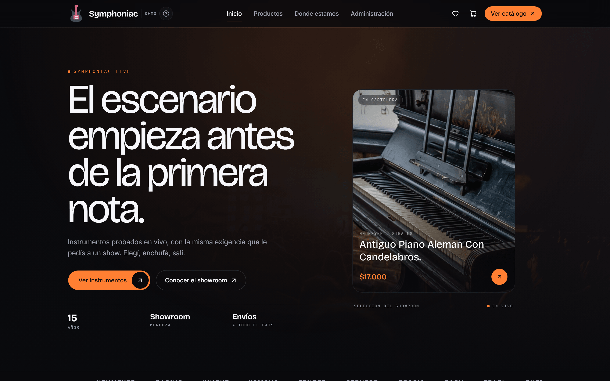
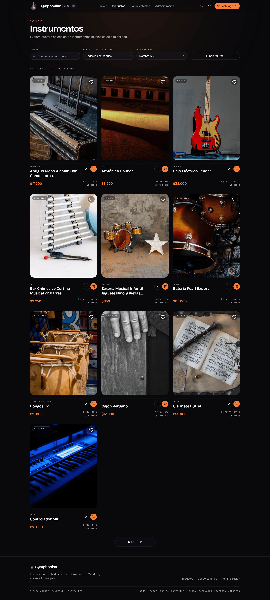
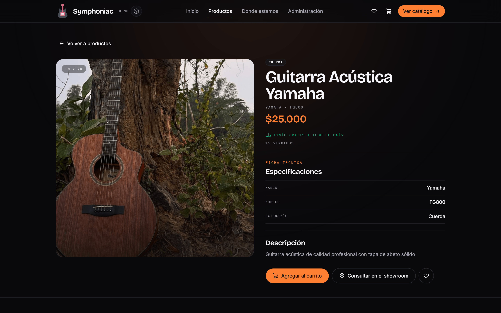
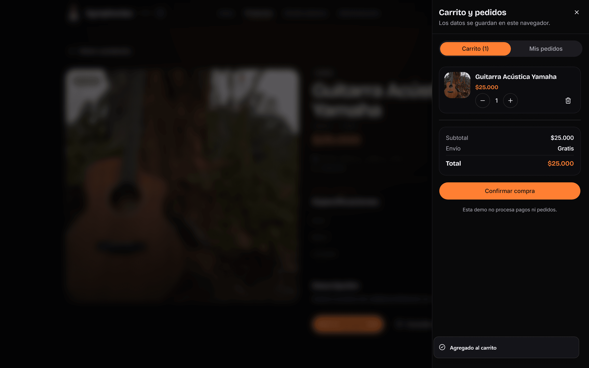
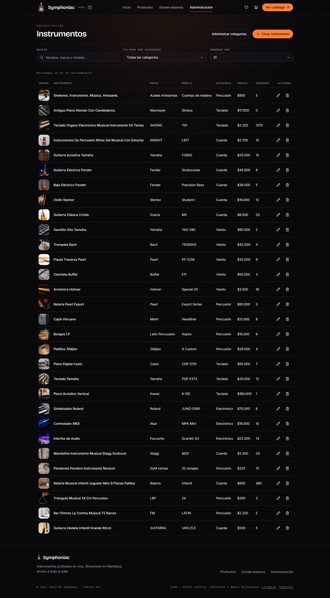
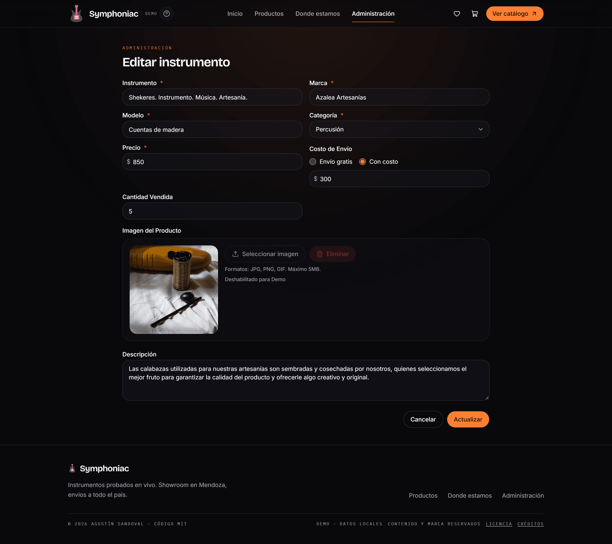
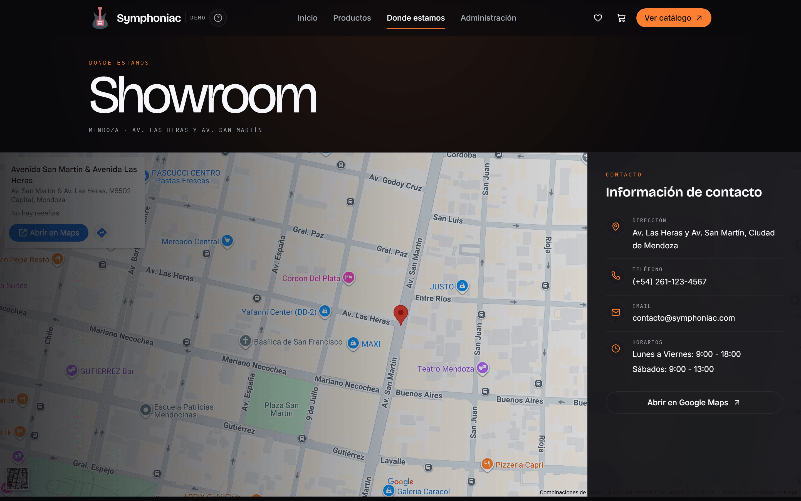

# Symphoniac

> Catálogo de instrumentos con búsqueda, filtros y panel de administración, con
> API REST y PostgreSQL. React 19 + Spring Boot 3.5, en un monorepo que se
> levanta con Docker.

[](https://github.com/AgusMS7/symphoniac/actions/workflows/ci.yml)
[](./LICENSE)

**[Ver código](https://github.com/AgusMS7/symphoniac)** · **[Contáctame](mailto:agustin.matias.sandoval@gmail.com)**

Demo de solo lectura, sin registro. 120 tests y CI en tres jobs.

React 19 · TypeScript · Spring Boot 3.5 · PostgreSQL 17 · Docker



## Por qué existe

Empezó como trabajo práctico de Laboratorio de Computación 4 (UTN FRM, 2025),
aprobado con 10. El pulido de portfolio agregó Docker Compose, tests de backend,
frontend y E2E, CI y un sistema de diseño propio. La demo es de solo lectura a
propósito: se recorre el catálogo y el panel sin escribir en la base. El objetivo
es mostrar el ciclo completo de una aplicación, no operar una tienda real.

## Para quién es

Para quien quiere ver un catálogo con panel de administración funcionando de
punta a punta, no una maqueta: API, PostgreSQL, tests y una demo que se prueba
sin riesgo. El dominio es una tienda de instrumentos; el interés está en cómo
está construida.

## Qué hace

- Catálogo de 30 instrumentos con búsqueda, filtro por categoría, orden y
  paginación de 10.
- Ficha de producto con imagen principal, galería y datos de la categoría.
- Panel de administración para instrumentos, categorías e imágenes; en local
  escribe en PostgreSQL; en la demo no toca la base.
- API REST con 24 endpoints, DTOs, validación y manejo global de errores.
- Demo de solo lectura: el backend responde 405 a escrituras; carrito y
  favoritos son locales.
- Entorno reproducible con Docker Compose (PostgreSQL + backend + Nginx).
- 120 tests y CI en tres jobs.

## Recorrido














## Cómo se usa

1. Levantá el stack local con `docker compose up -d --build`.
2. Abrí `http://localhost:8081` y recorré el catálogo; probá la búsqueda y
   agregá un instrumento al carrito.
3. Entrá a `/admin` para ver el panel; en la demo el panel no escribe en la
   base. La subida de imágenes está deshabilitada.

Resultado esperado: `http://localhost:8081` sirve la SPA; `/api/instrumentos`
devuelve 30 instrumentos; `/images/acoustic-guitar.jpg` devuelve una imagen.
El backend arranca con el perfil `demo`: las lecturas funcionan y las
escrituras directas sobre `/api/**` responden 405.

En la demo, el panel de administración se recorre y permite editar; los cambios
se guardan en el navegador (`localStorage`), no en la base. El backend responde
405 a cualquier escritura directa y la subida de imágenes está deshabilitada. Es
una decisión de diseño: la demo no modifica datos reales.

El esquema y el seed se aplican cuando se inicializa el volumen `pgdata`.
`docker compose down -v` borra ese volumen y vuelve a sembrar la base en el
próximo `up`; no lo uses sobre una base con datos que quieras conservar.

## Cómo está construido

| Capa | Tecnología | Rol |
|---|---|---|
| Frontend | React 19 + TypeScript 5.9 + Vite 7 | SPA con rutas lazy, Tailwind v4 y shadcn/ui |
| Backend | Java 17 + Spring Boot 3.5.16 | API REST, JPA, validación, uploads |
| Datos | PostgreSQL 17 | 5 tablas; esquema y seed reproducibles |
| Orquestación | Docker Compose | db + backend + frontend + Nginx |
| Tests | JUnit + Vitest + Playwright | 22 backend + 89 frontend + 9 E2E |
| Deploy | Render + Neon + Vercel | Planificado; ver [despliegue](docs/deployment.md) |

```text
navegador -> nginx (frontend:8080) -> /api/* -> backend:3001 -> PostgreSQL:5432
                                  -> /images/* -> backend:3001
```

Decisiones con motivo:

- **Compose para reproducibilidad.** Un comando levanta db, backend y frontend;
  el esquema y el seed se aplican al crear el volumen.
- **Nginx como único origen.** Evita CORS en el navegador y sirve la SPA y los
  assets desde el mismo puerto.
- **Perfil demo read-only.** El backend bloquea escrituras con 405; el frontend
  guarda carrito, favoritos y cambios del panel en `localStorage`. La demo se
  prueba sin riesgo.
- **JPA `validate` + SQL versionado.** El esquema no se genera solo; se aplica
  desde `backend/db/schema.sql` y `backend/db/seed.sql`.
- **DTOs y manejo global de errores.** La API no expone entidades crudas y
  responde con un sobre uniforme.

## Números y evidencia

| Dato | Valor | Cómo se verificó |
|---|---|---|
| Instrumentos | 30 | `backend/db/seed.sql` |
| Categorías | 5 | `backend/db/seed.sql` |
| Endpoints de API | 24 | controllers; excluye `GET /` de estado |
| Tests backend | 22 | `.\mvnw.cmd test` |
| Tests frontend | 89 | `npm run test` |
| Tests E2E | 9 | `npm run test:e2e` |
| Vulnerabilidades npm | 0 | `npm audit` (2026-11-27) |
| Bundle de producción | Entry `index`: 265.48 kB (82.78 kB gzip); total emitido 887.66 kB | `npm run build` (2026-11-27) |

Las imágenes de seed son fotografías de stock de Pexels; autor, URL y licencia
están en
[`backend/src/main/resources/static/images/CREDITS.md`](backend/src/main/resources/static/images/CREDITS.md).

## Configuración

| Variable | Requerida | Default | Propósito |
|---|---|---|---|
| `DB_USER` | Sí | `postgres` | Usuario de PostgreSQL |
| `DB_PASSWORD` | Sí | — | Password de PostgreSQL |
| `FRONT_PORT` | No | `8081` | Puerto del frontend en el host |
| `DB_URL` | Sí | `jdbc:postgresql://db:5432/symphoniac` | Conexión JDBC |
| `PORT` | No | `3001` | Puerto del backend |
| `CORS_ALLOWED_ORIGINS` | No | `http://localhost:8081` | Orígenes permitidos |
| `UPLOAD_DIR` | No | `/app/uploads` | Directorio de uploads |
| `SPRING_PROFILES_ACTIVE` | No | `demo` | Perfil `demo` o `default` |
| `VITE_API_URL` | No | `/api` | Base de la API en el frontend |
| `VITE_IMAGES_URL` | No | `/images` | Base de imágenes en el frontend |
| `VITE_DEMO` | No | `true` | Activa el modo demo |

Solo nombres y defaults de desarrollo; nunca valores reales. Los `.env` reales
no se versionan: se copian desde `.env.example`. Detalle en
[configuración](docs/configuration.md).

## Calidad

```bash
docker compose up -d --build
.\mvnw.cmd verify
cd frontend
npm ci
npm run lint
npm run test
npm run build
npm run test:e2e
```

CI en GitHub Actions: 3 jobs (`backend`, `frontend`, `e2e`). El job E2E levanta
el stack demo con Docker y corre Playwright. Responsive verificado en 5
breakpoints; las capturas de este README son de escritorio.

Detalle de tests, cobertura y política anti-flaky en [tests](docs/testing.md).

## Estado y límites

- Demo de solo lectura: el backend responde 405 a escrituras; el panel se
  recorre y guarda cambios en el navegador; la subida de imágenes está
  deshabilitada.
- Sin login ni autenticación: el panel es de demo, no un backoffice seguro.
- Sin checkout ni pagos; carrito y favoritos son locales.
- Pedidos: API disponible, sin flujo de compra en el frontend.
- Imágenes de seed: stock libre, no productos reales; precios ficticios.
- Deploy público: planificado; todavía no hay URL pública.
- Búsqueda, filtro, orden y paginación se resuelven en el cliente.

El detalle completo está en [límites conocidos](docs/known-limitations.md).

## Documentación

- [Arquitectura](docs/architecture.md)
- [API](docs/api.md)
- [Configuración](docs/configuration.md)
- [Despliegue](docs/deployment.md)
- [Resolución de problemas](docs/troubleshooting.md)
- [Límites conocidos](docs/known-limitations.md)
- [Tests](docs/testing.md)
- [Sistema de diseño](docs/design-system.md)

## Autor y licencia

Desarrollado por **Agustín Sandoval**. Código bajo [MIT](./LICENSE); marca y
contenido en [NOTICE.md](./NOTICE.md).

**Contáctame:** [agustin.matias.sandoval@gmail.com](mailto:agustin.matias.sandoval@gmail.com)
